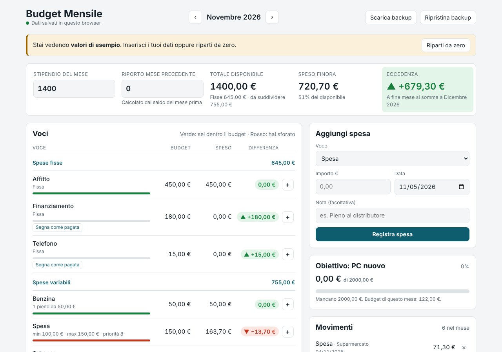

# Budget Mensile

Web app per pianificare lo stipendio: inserisci quanto guadagni e le spese fisse, e l'app **suddivide automaticamente** il resto tra le voci variabili in base alle tue priorità. Per ogni voce mostra budget, spesa effettiva e differenza (verde se sei dentro, rosso se hai sforato). A fine mese l'eccedenza o l'ammanco passa al mese successivo.

**[Prova l'app →](https://giuseppevalguarnera.github.io/budget-mensile/)**



## Funzionalità

- **Suddivisione automatica del budget** con priorità (0–10), minimi e massimi per ogni voce
- **Voci a rifornimenti** (es. benzina: costo di un pieno × numero di pieni al mese)
- **Obiettivi di risparmio** su più mesi (es. PC nuovo da 2000 €) con barra di avanzamento: la voce smette di ricevere soldi quando l'obiettivo è raggiunto
- **Budget, speso e differenza** per ogni voce, con indicatori verde/rosso
- **Riporto automatico**: l'eccedenza si somma al mese dopo, l'ammanco si sottrae
- **Storico mese per mese**: le modifiche alle voci valgono dal mese corrente in avanti, i mesi passati restano invariati
- **Nessun account**: i dati restano nel browser (localStorage), con backup e ripristino in JSON
- **PWA**: installabile sul telefono e utilizzabile offline
- Interfaccia responsive, tema chiaro/scuro automatico, accessibile da tastiera

## Come funziona la suddivisione

1. Dallo stipendio più il riporto si tolgono le spese fisse.
2. Ogni voce variabile riceve il suo **minimo** (la benzina riceve costo × pieni). Se il denaro non basta, i minimi vengono ridotti in proporzione.
3. Il resto viene diviso **in proporzione alla priorità**. Una voce che raggiunge il **massimo** si ferma e la sua parte in eccesso viene ridistribuita alle altre (algoritmo *water filling*).
4. Gli importi vengono arrotondati all'euro mantenendo invariato il totale (metodo dei resti più grandi).

La logica è in [`src/lib/allocation.js`](src/lib/allocation.js) ed è coperta da test.

## Tecnologie

- [React 19](https://react.dev) con hook personalizzati (`useBudget`)
- [Vite](https://vite.dev) per sviluppo e build
- [Vitest](https://vitest.dev) per i test unitari
- CSS puro con variabili (nessuna libreria UI)
- GitHub Actions per test e pubblicazione automatica su GitHub Pages

## Struttura

```
src/
├── App.jsx              # composizione della pagina
├── hooks/useBudget.js   # stato, salvataggio e azioni
├── lib/                 # logica pura, senza React
│   ├── allocation.js    # algoritmo di suddivisione
│   ├── budget.js        # calcoli del mese, riporto, obiettivi
│   ├── defaults.js      # voci iniziali e dati di esempio
│   ├── format.js        # formattazione e lettura degli importi
│   ├── months.js        # utilità per i mesi
│   └── storage.js       # localStorage
└── components/          # interfaccia
```

## Avvio in locale

```bash
npm install
npm run dev      # http://localhost:5173
npm test         # test unitari
npm run build    # build di produzione in dist/
```

## Licenza

MIT © Giuseppe Valguarnera
